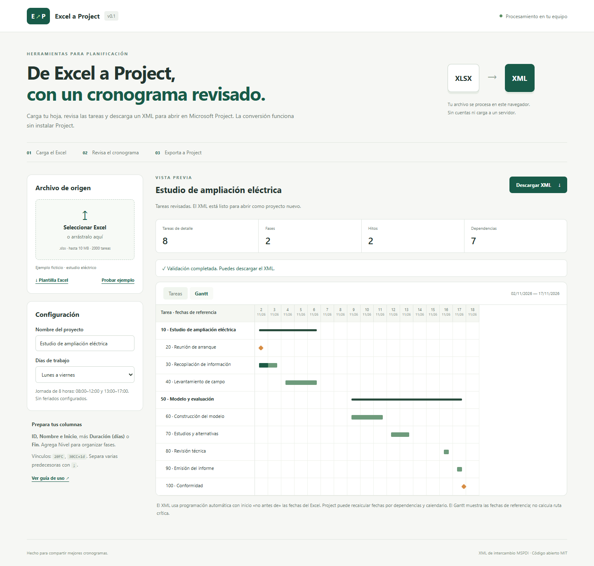

# Excel a Project

Convierte un cronograma de Excel a XML de intercambio MSPDI para Microsoft Project. Incluye validaciones por fila y vista previa de tareas y Gantt. La conversión se ejecuta en el navegador: el Excel no se carga a un servidor.



## Uso sin instalar programas

Abre `dist/index.html` en un navegador moderno. El archivo contiene la aplicación, el lector Excel y la plantilla. Funciona sin conexión. La carpeta `dist` se genera con el comando de construcción indicado más abajo y también sirve para publicar en GitHub Pages.

1. Descarga la plantilla desde la aplicación.
2. Sustituye los datos ficticios por tus tareas. Conserva los encabezados en la primera fila.
3. Carga el `.xlsx` y elige la hoja y el calendario.
4. Corrige los errores. Revisa los avisos y confirma su lectura antes de exportar.
5. Descarga el XML.
6. En Microsoft Project de escritorio, selecciona **Archivo → Abrir**, elige el XML y ábrelo como **proyecto nuevo**.

La conversión no requiere Microsoft Project. Para abrir el XML y guardarlo como `.mpp` se necesita Project u otra aplicación compatible. Este proyecto no crea archivos binarios MPP.

## Formato del Excel

La hoja `Tareas` se selecciona de forma preferente. También puedes elegir otra hoja. No uses filas de título antes de los encabezados.

| Columna | Regla |
| --- | --- |
| ID | Obligatorio. Entero positivo único. Se conserva en Notas. El XML asigna UID consecutivos y remapea los vínculos para una importación consistente; Project muestra números de fila consecutivos. |
| Nombre | Obligatorio. Entre 1 y 512 caracteres. |
| Nivel | Opcional. Predeterminado 1. Jerarquía de 1 a 20, sin saltar más de un nivel al bajar. Una fila con descendientes es un resumen. |
| Inicio | Obligatorio para tareas de detalle. Fecha Excel, `AAAA-MM-DD` o `DD/MM/AAAA`; hora opcional `HH:mm`. Sin hora: 08:00. |
| Duración (días) | Duración laboral, con 8 horas por día. 0 representa un hito. Se admiten fracciones equivalentes a minutos enteros. |
| Fin | Alternativa a Duración o control opcional. Sin hora: 17:00. Si se completan ambos, deben coincidir con el calendario. En hitos, Inicio y Fin deben señalar el mismo instante. |
| Predecesoras | IDs del Excel, separados por `;` o `,`. Ejemplo: `20FC;30CC+1d`. |
| Responsable | Se exporta como Contacto. No crea un recurso ni una asignación de trabajo. |
| Avance físico (%) | Entero de 0 a 100. Se exporta a PhysicalPercentComplete, sin inventar fechas reales ni avance por duración. |
| Notas | Texto libre. |

Deja Inicio, Duración y Fin vacíos en los resúmenes. La aplicación calcula sus límites desde las tareas de detalle. El orden del Excel define la jerarquía; no se ordena por ID.

Relaciones admitidas: **FC/FS**, **CC/SS**, **FF**, **CF/SF**. Los desfases aceptan días laborales de 8 horas (`+1d`) u horas (`-2h`), con punto decimal. La ausencia de tipo equivale a FC. No se permiten ciclos, vínculos a resúmenes, IDs inexistentes ni dependencias de una tarea consigo misma.

## Qué significan las fechas

El calendario global admite lunes a viernes, lunes a sábado o todos los días. Todos usan 08:00–12:00 y 13:00–17:00. No se incluyen feriados ni calendarios por recurso.

La aplicación calcula el fin a partir del inicio y la duración laboral. Exporta tareas automáticas con restricción **Inicio no anterior al** (`ConstraintType=4`) y los vínculos indicados. Project puede reprogramar fechas al resolver dependencias. La vista previa muestra las fechas de referencia y no implementa el motor de programación de Project ni calcula ruta crítica, holguras o nivelación.

Las fechas se tratan como hora local sin zona, con aritmética UTC interna para evitar desplazamientos por zona horaria. Las fórmulas no se ejecutan: se utiliza su resultado almacenado con un aviso. Las fórmulas sin resultado guardado y las celdas con error bloquean la conversión.

## Desarrollo

Requiere Node.js 20 o posterior. No hay instalación de paquetes para ejecutar, construir o probar.

```sh
npm test
npm start
npm run build
```

También se pueden ejecutar directamente `node --test`, `node scripts/serve.mjs` y `node scripts/build.mjs`. El servidor de desarrollo escucha solo en `127.0.0.1:4173`. `PORT` permite cambiar el puerto.

El código de conversión está en `src/core.mjs`, la lectura del libro en `src/workbook.mjs` y la interfaz en `src/app.mjs`. La biblioteca ExcelJS 4.4.0 se incluye en `vendor` bajo licencia MIT. Su licencia se conserva junto con la aplicación distribuida. La plantilla estática se guarda en `public`; su copia codificada está en `src/template-data.mjs` para el uso sin conexión.

## Pruebas y límites

Las pruebas automáticas verifican calendarios, fines de semana, pausas de almuerzo, fechas inválidas, hitos, jerarquía, dependencias circulares, desfases, escape XML y lectura de la plantilla real. El flujo del navegador y la compatibilidad con Project se documentan en `docs/VALIDACION.md`.

Límites de esta versión: 10 MB por XLSX, 100 MB descomprimidos, 2000 tareas, 100 columnas y fechas entre 1901 y 2100. Solo `.xlsx`. No importa `.mpp`, `.xls`, `.xlsm`, macros, costos, recursos, líneas base, datos de tiempo distribuido ni proyectos vinculados. No contiene telemetría ni llamadas de red desde la aplicación distribuida. El proveedor que aloje la página puede registrar las visitas HTTP, sin recibir el contenido del Excel por parte de esta aplicación.

## Publicar en GitHub Pages

El flujo de integración comprueba pruebas y construcción. El flujo de publicación es manual para que subir código no publique automáticamente la web.

1. Sube este directorio a un repositorio de GitHub.
2. En **Settings → Pages**, selecciona **GitHub Actions** como fuente.
3. Ejecuta **Actions → Publicar aplicación → Run workflow**.

El despliegue publica exclusivamente `dist`. No incluyas archivos reales de clientes al crear incidencias, capturas o ejemplos.

## Referencias del formato

- [Estructura Project de Microsoft](https://learn.microsoft.com/en-us/office-project/xml-data-interchange/project-element)
- [Esquema XML de tareas](https://learn.microsoft.com/en-us/office-project/xml-data-interchange/xml-schema-for-the-tasks-element)
- [Vínculos de predecesoras y unidades de desfase](https://learn.microsoft.com/en-us/office-project/xml-data-interchange/predecessorlink-element)
- [Calendarios](https://learn.microsoft.com/en-us/office-project/xml-data-interchange/xml-schema-for-the-calendars-element)
- [ExcelJS](https://github.com/exceljs/exceljs)

## Contribuir

Abre una incidencia con pasos reproducibles y un Excel mínimo de datos ficticios. Las mejoras propuestas incluyen mapeo visual de columnas, calendarios con feriados, recursos y exportación de un informe de validación. Toda ampliación del XML debe incorporar una prueba de lectura y una comprobación en un consumidor compatible.

Licencia MIT. Herramienta independiente, sin afiliación con Microsoft.
